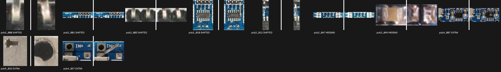

# Pocket AOI

From one phone photo, find assembly mistakes on a circuit board by comparing it with a known-good golden board, and say what each mistake will break.

Built for the Meta Global AI Developer Hackathon (manufacturing). The full spec is in [AGENTS.md](AGENTS.md).

## What was built during the hackathon

The hackathon began on 26 Oct 2026. This repo's first commit is dated 3 Nov 2026 and there was no earlier codebase, so `git log` shows the whole history.

**Built during the hackathon:**

- The pipeline in `src/pocket_aoi/`: board setup, alignment, part location, comparison, verdicts, consequences and the report, including the rule that Muse Glimmer can only confirm or reject what classical vision raises
- The prompts in `prompts/`, and the checks that reject replies citing parts, pads or nets not in the netlist
- The pin-swap table and severity rules
- The Gradio page in `app/`, and the Kaggle notebook in `notebooks/`
- The evaluation in `eval/`, and every result in this README

**Not built here, and used as they are:**

- SAM 3.1 and Muse Glimmer 30B, Meta's models
- The VisA and PCBA datasets, and the kit photos and ArduTouch schematic listed under [Data and credits](#data-and-credits)
- The open-source libraries in `pyproject.toml`, such as PyTorch, transformers, OpenCV and Gradio

## The problem

In student labs, assembly mistakes cost more debugging time than design errors: a reversed electrolytic, an IC seated backwards, a missing resistor. Factory optical inspection machines cost tens of thousands of dollars, so students, makers and small shops inspect by eye.

Pocket AOI needs a phone, one photo of a correctly assembled board, and optionally the board's netlist. It returns:

- the test photo with each fault outlined
- a safe-to-power banner
- one card per fault, for example "C7 missing: U2 loses its decoupling cap"

## How it works

Every decision starts from the golden board. Each golden part is checked at its own spot in the aligned test photo, and Muse Glimmer only confirms or rejects what classical vision raises. It can never add a fault of its own.

| Stage | What happens | Uses |
| --- | --- | --- |
| 0. Board setup | Find the parts on the golden photo, give each its ref, and save a profile. Once per design. | SAM 3.1, a person checking refs, optionally Muse Glimmer reading the silkscreen |
| 1. Align | Warp the test photo into the golden board's frame, or ask for a retake and say why | SAM 3.1, SIFT |
| 2. Segment | Find where every part is, with one prompt on the full image and overlapping tiles | SAM 3.1 |
| 3. Compare | Match parts by position, compare each crop at a coarse scale, and test polarized parts for rotation. Tuned to miss nothing, so false alarms are expected here. | OpenCV, scikit-image |
| 4. Verdicts | Show Muse Glimmer the golden and test crops side by side, and keep, drop or flag each suspect | Muse Glimmer 30B |
| 5. Consequences | Write a card from netlist facts and an exact pin-swap table, with severity floors set by rules. Every cited part, pad and net is checked against the netlist. | Muse Glimmer 30B |
| 6. Report | Draw the overlay on the original photo, and write `report.html`, `report.json` and `overlay.png` | OpenCV |

## Models

| Role | Model |
| --- | --- |
| Board outline and part masks | SAM 3.1 by Meta, loaded from [unsloth/sam3.1](https://huggingface.co/unsloth/sam3.1), a transformers-format conversion of Meta's weights under the SAM License. It is not an official Meta release. |
| Crop verdicts, silkscreen reading and consequence text | [Muse Glimmer 30B](https://huggingface.co/meta-models/Muse-Glimmer-30B) by Meta, Apache 2.0 |

Nothing is trained or fine-tuned. Muse Glimmer sits behind one OpenAI-compatible client, so switching backends only changes `.env`.

## Results

Every number here comes from real photos of real defects. Synthetic defects are never counted.

**In short:** across 134 photos of 4 boards, Pocket AOI flagged 60 of 70 defects on the board (86%) and named the right type for 46 (66%). A further 24 defects sit outside the board's outline, and 9 of those were flagged. Muse Glimmer removed about half of the false alarms, and all 60 stayed flagged. A report still has about 2 false alarms per clean photo, and it misses most reversed parts, so treat it as a list of places to look.

### Main evaluation: VisA

[VisA](https://github.com/amazon-science/spot-diff) has real defects on four small boards. The test used every defect photo in its test split, plus 10 clean photos per board: 134 of 254 photos. A fixed seed chose the clean photos before any test result was read, and thresholds were tuned only on a separate development split.

Results for the full pipeline, per board:

| Board | Photos | Found, right type | Found, any type | False alarms per clean photo | Clean photos with a false alarm | False alarms per defect photo | Needs review per photo |
| --- | --- | --- | --- | --- | --- | --- | --- |
| visa-pcb1 | 28 | 1/6 (17%) | 6/6 (100%) | 0.10 | 1/10 | 0.17 | 0.11 |
| visa-pcb2 | 28 | 8/14 (57%) | 8/14 (57%) | 1.20 | 5/10 | 1.44 | 0.61 |
| visa-pcb3 | 30 | 7/12 (58%) | 11/12 (92%) | 2.30 | 9/10 | 2.85 | 0.77 |
| visa-pcb4 | 48 | 30/38 (79%) | 35/38 (92%) | 4.20 | 10/10 | 4.32 | 0.79 |
| **All** | **134** | **46/70 (66%)** | **60/70 (86%)** | **1.95** | **25/40** | **2.66** | **0.60** |

Per defect type:

| Defect | Photos | Found, right type | Found, any type | False alarms per defect photo | Needs review per photo |
| --- | --- | --- | --- | --- | --- |
| Missing | 47 | 25/34 (74%) | 32/34 (94%) | 2.55 | 0.57 |
| Extra | 15 | 7/15 (47%) | 12/15 (80%) | 4.13 | 1.20 |
| Bent | 26 | 8/15 (53%) | 10/15 (67%) | 1.46 | 0.38 |
| Wrong place | 6 | 6/6 (100%) | 6/6 (100%) | 5.00 | 0.50 |

What Muse Glimmer adds, over the same 134 photos:

| Pipeline | Found, right type | Found, any type | False alarms per clean photo | False alarms per defect photo | Needs review per photo |
| --- | --- | --- | --- | --- | --- |
| Classical vision only | 34/70 (49%) | 60/70 (86%) | 4.05 | 4.85 | 0.00 |
| With Muse Glimmer | 46/70 (66%) | 60/70 (86%) | 1.95 | 2.66 | 0.60 |

False alarms fell from 618 to 328 (47%). All 748 verdict calls got a valid reply.

Read these numbers with care:

- **Not the intended use.** VisA's boards are small and mostly surface-mount, and were shot from a fixed camera. With no hardware available, a handheld phone photo of a through-hole kit with real defects has not been measured.
- **Consequence cards are not measured.** VisA has no netlists, so Stage 5 did not run in this test. The only cards from the model so far are on a demo photo with defects edited in. On that photo, the parts, pins and nets they cite were checked by hand against the netlist and were right, and one of the four says its effect cannot be determined.
- **One defect per photo.** VisA gives one combined mask per photo, so a photo tagged "scratch, missing" counts as one defect. A defect counts as found when a flagged box overlaps its mask by 30% of the smaller area. For the right type, a bent part accepts SHIFTED or WRONG_PART, and a part in the wrong place accepts SHIFTED, MISSING, EXTRA or WRONG_PART.
- **Off the outline.** Another 24 defects sit mostly outside the board's outline, such as bent pins hanging off the edge, where the comparison frame does not reach. They are not in the tables above. With Muse Glimmer 9 were flagged, against 10 without it.
- **A labelling error on `pcb1`.** Muse Glimmer called 5 of its 6 missing parts WRONG_PART. They stay flagged, but the label is wrong: in photo 050 the part is plainly gone, with bare pads showing.
- **Red banners.** No clean photo had an orientation false alarm on an IC or electrolytic, the case the rules make CRITICAL. Six of the 40 had one on another part. Stage 5 did not run here, so this comes from the rule alone.
- **How the run went.** The 4-bit build of Muse Glimmer ran on Kaggle's free GPUs. The first run reached about 25 photos before the rotation test was replaced, because of the reversed-part results below. It was restarted, with nothing tuned on those photos. A Kaggle session then ended at photo 117, and the run resumed with the same model build and saved replies.

Every miss and false alarm, as crop pairs with the golden board on the left and the test photo on the right:



- [The 78 false alarms on clean photos](docs/results/false_alarms_clean.jpg)
- [The 250 false alarms on defect photos](docs/results/false_alarms_defect_photos.jpg)

Many false alarms are real differences that do not matter, such as a non-polar resistor fitted the other way round, or soldered leads that differ between boards. Allowing a 180° turn on non-polar parts looks like the clearest next fix. It is not applied here, because that would be tuning on the test set.

### Time per photo

| Stage | Time | Measured on |
| --- | --- | --- |
| Align | 5.0 s (median) | 8 GB M2, through MPS |
| Find parts | 21.6 s (median) | 8 GB M2, through MPS |
| Verdicts | about 30 s per suspect, with a median of 5 suspects per photo | Kaggle's 2× T4, 4-bit build |
| Consequence cards | about 2 minutes per fault | Kaggle's 2× T4, 4-bit build |

The demo photo, with 4 faults, took about 10 minutes in all on that setup. Verdicts took 11–14 s per call on OpenRouter. The evaluation's own verdict timing is left out, because the restarted run read saved replies.

### Reversed parts

**Pocket AOI misses most reversed parts on real photos, so check polarized parts by eye before powering a board.** The report's banner says the same.

The main evaluation's dataset has no reversed parts, so this is a separate test on the [PCBA set](https://universe.roboflow.com/123-1fark/pcba-lw1r1): phone photos of one board design with diodes and electrolytic capacitors really fitted backwards. The method was designed on its `train` shots, then scored once on its `test` and `valid` shots:

| Part | Reversed: confirmed REVERSED | Reversed: confirmed, any fault type | Unlabelled parts: confirmed fault |
| --- | --- | --- | --- |
| D1 (diode) | 2/6 | 3/6 | 3/6 |
| D2 (diode) | 3/9 | 5/9 | 2/6 |
| E1 (electrolytic) | 0/4 | 0/4 | 0/2 |
| E2 (electrolytic) | 0/2 | 0/2 | 0/11 |
| E4 (electrolytic) | 3/3 | 3/3 | none |
| **All** | **8/24 (33%)** | **11/24 (46%)** | **5/25 (20%)** |

All 13 misses were parts classical vision never flagged, so Muse Glimmer never saw them. It confirmed all 11 that it did see.

Read these numbers with care:

- **Not the whole pipeline.** These are 640 × 640 close-ups, most of which never show the whole board, so they skip Stages 1 and 2. Each photo is aligned to a correct photo of the same part with the pipeline's own SIFT code, and part boxes come from the dataset's labels rather than SAM.
- **A small sample.** It is one board design, and many shots were taken seconds apart, so they are not independent.
- **Imperfect controls.** "Unlabelled" does not always mean correct: 2 of 12 sampled unlabelled parts turned out to have empty pads.

The original rotation test called 0 of 69 of these parts REVERSED, a flaw that synthetic defects had not exposed. The fix helped but did not solve it. Sending every polarized part to Muse Glimmer was tried and rejected, because it flagged 5 of 10 correct parts in a small sample.

## Limitations

- **Solder joints** are not inspected, because they sit on the underside of a through-hole board.
- **Wrong values in identical bodies**, such as 1 kΩ against 10 kΩ, cannot be told apart.
- **Fine-pitch SMD boards** are out of scope.
- **Anything outside the board's outline**, such as a bent header pin hanging off the edge, is not seen, because the comparison frame is cropped to the board.
- **Reversed parts are often missed**, as the results above show. A report with no faults does not mean a board is safe to power.
- **False alarms are common**, at about 2 per clean photo, and more on busy boards. Expect to check a few flagged parts by eye.
- **Phone photos of through-hole kits with real defects are untested**, as the results above explain.
- **Each design needs a golden board**, photographed once and labelled.

## Setup

Needs Python 3.11 or newer. These commands use [uv](https://docs.astral.sh/uv/).

```bash
uv venv --python 3.11 .venv
uv pip install --python .venv/bin/python -e ".[dev]"
cp .env.example .env    # then set LLM_API_KEY
.venv/bin/pytest        # no network or GPU needed
```

SAM 3.1 runs on an NVIDIA GPU or on Apple silicon through MPS. On an 8 GB M2 it takes about 27 s per photo, including alignment. Muse Glimmer can run on a hosted backend, which the default `.env.example` uses, or on your own server.

## Using it

```bash
# Once per design: find the parts, then edit boards/<id>/refs.yaml and rebuild without running SAM again
.venv/bin/pocket-aoi setup-board --board-id ardutouch --golden golden.jpg --netlist netlist.json
.venv/bin/pocket-aoi relabel --board-id ardutouch

# Inspect one photo. --cv-only stops after Stage 3, without calling Muse Glimmer
.venv/bin/pocket-aoi inspect --board-id ardutouch --photo test.jpg

# Or use the web page, with --share for a public link
.venv/bin/python app/gradio_app.py
```

For a polarized part, you can tell Muse Glimmer where its marker sits on the golden board by adding `marker_hint` to the part's line in `refs.yaml`, for example `marker_hint: band at the bottom end`. On 12 development photos of reversed parts, hints raised correct REVERSED calls from 3 to 7.

`inspect` writes to `runs/<board>_<photo>/`: `report.html`, `report.json`, `overlay.png`, `votes.json` with both votes per suspect, the composites Muse Glimmer saw, and debug images for each stage.

To score the pipeline against ground truth, with both CV only and CV plus Muse Glimmer from one run:

```bash
# Every defect photo, plus 10 clean photos per board. Results land in runs/eval/final/
.venv/bin/pocket-aoi eval --gt eval/ground_truth/ --split test --clean-per-board 10 --tag final

# Draw every miss and false alarm as crop pairs, into docs/results/
.venv/bin/python -m eval.make_result_sheets --tag final

# The reversed-part test, which needs a free Roboflow key in .env. Results land in runs/eval/polarity/
.venv/bin/python -m eval.fetch_roboflow_pcba
.venv/bin/python -m eval.run_polarity_eval --holdout
```

## Taking photos

Hold the phone 25–35 cm above and roughly parallel to the board, with the board filling most of the frame. Use diffuse light with no flash, on a plain background that contrasts with the board. Save photos as JPEG; on an iPhone, set Settings > Camera > Formats to Most Compatible.

## Data and credits

Apart from the small crops in `docs/results/`, none of these photos are stored in this repo.

- [VisA dataset](https://github.com/amazon-science/spot-diff) by Zou et al., CC BY 4.0: real photos of real defects, used for the main results and the crops in `docs/results/`
- [PCBA dataset](https://universe.roboflow.com/123-1fark/pcba-lw1r1) by user 123 on Roboflow Universe, CC BY 4.0: real photos of real reversed parts, used for the reversed-part test
- ArduTouch kit by [Mitch Altman](https://commons.wikimedia.org/wiki/File:ArduTouch_music_synthesizer_Rev_C_Assembled,_by_Cornfield_Electronics_(2023-03-19_12.20.37_by_Mitch_Altman_@Flickr_52930161269).jpg), CC BY-SA 2.0, with its [design files](https://github.com/maltman23/ArduTouch), whose schematic is CC BY-SA 3.0, as the source of the demo board's netlist
- Electronic die kit by Raimond Spekking ([top-down](https://commons.wikimedia.org/wiki/File:Assembled_Kit_for_electronic_cube-2461.jpg), [angled](https://commons.wikimedia.org/wiki/File:Assembled_Kit_for_electronic_cube-2460.jpg)), CC BY-SA 4.0

## Licence

The code, prompts and configs are under the [MIT License](LICENSE). It does not cover the following:

- **Models:** SAM 3.1 is under the SAM License and Muse Glimmer 30B under Apache 2.0. Neither is stored in this repo.
- **`docs/results/` and `eval/ground_truth/visa/`:** crops and labels from VisA, CC BY 4.0.
- **`boards/`:** part labels for the third-party boards credited above, and `boards/ardutouch/netlist.json`, which comes from the ArduTouch schematic and is shared under that schematic's CC BY-SA 3.0.
